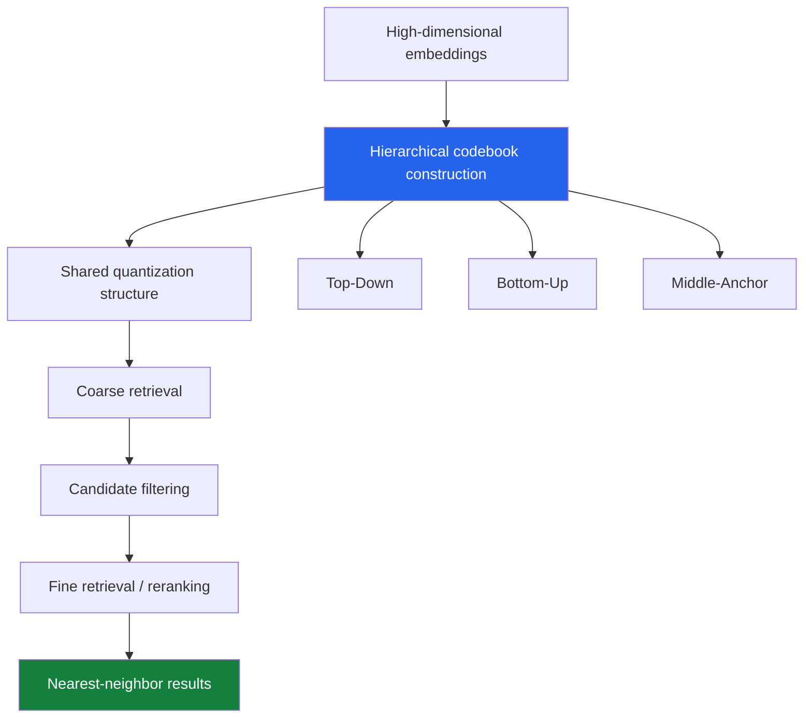
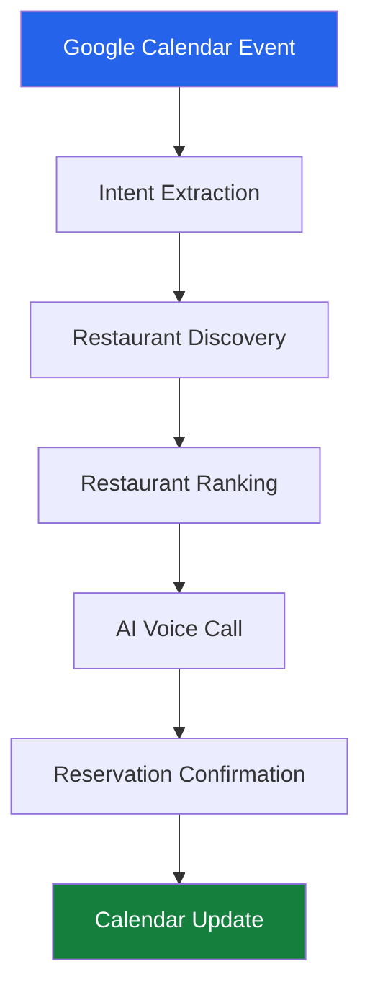

# Shashwat Saket 👋

<p align="center">
  
</p>

<p align="center">
  <a href="https://linkedin.com/in/shashwatsaket46"></a>
  <a href="https://github.com/shashwatsaket46"></a>
  <a href="mailto:shashwat.saket@nyu.edu"></a>
</p>

I'm a Computer Science graduate student at **New York University**, interested in machine learning, representation learning, and computational neuroscience.

My work spans a few different directions: efficient vector quantization and nearest-neighbor search, deep learning for neural signal decoding, and computational methods for understanding biological neural networks.

I enjoy getting into the details of a problem: understanding the mathematics, implementing an idea, running experiments, and figuring out why something works or doesn't.

Before graduate school, I worked as a Software Engineer at **CGI Inc.**, building enterprise applications, intelligent automation systems, and ML-powered services.

---

# 🔬 Research

## Understanding Neural Connectivity Through Biological Data

**Graduate Researcher | NYU Neuroinformatics Lab**  
*New York University · May 2026 – Present*

Working with Prof. Erdem Varol on the Drosophila visual system, investigating the relationship between neuronal connectivity and gene expression.

The broader question is whether molecular information can help explain the connectivity patterns observed in biological neural networks.

My current work involves:

- Integrating connectome, transcriptomic, and gene-expression datasets.
- Developing computational methods for neuronal cell-type identification.
- Investigating gene-pair associations between presynaptic and postsynaptic neurons.
- Building transformer-based filtering and analysis pipelines.
- Running large-scale experiments using GPU-accelerated infrastructure.
- Exploring connectivity patterns across different neuropils and neural circuits.

A particularly interesting aspect of this work is connecting molecular identity with the structure of neural circuits.

**Research interests:** Connectomics · Multimodal Learning · Computational Neuroscience · Graph Machine Learning · Biological Data Integration

---

# 🧠 Featured Research

## 1. Reusable Hierarchical Codebooks for Approximate Nearest-Neighbor Search

One of my major research projects focuses on making vector quantization more efficient through reusable hierarchical codebooks.

The central question is straightforward: can a shared hierarchical quantization structure support multiple retrieval stages without requiring independently constructed codebooks?

The project investigates a two-tier retrieval strategy in which a shared codebook structure supports coarse candidate filtering followed by finer retrieval.

What makes this interesting is that codebook construction is not just an implementation detail. The way quantization levels are constructed directly influences how reconstruction errors accumulate and, ultimately, how well nearest-neighbor relationships are preserved.

### Three codebook construction strategies

I investigated three different approaches:

| Strategy | Construction approach |
|---|---|
| **Top-Down** | Start with a coarse representation and progressively refine it. |
| **Bottom-Up** | Construct finer representations first and combine them into coarser levels. |
| **Middle-Anchor** | Use an intermediate quantization level as the reference for constructing the hierarchy. |

### How the framework works



### Mathematical and theoretical analysis

An important part of this research was understanding how quantization error behaves across hierarchical levels.

The work involved mathematical analysis of:

- Conservation of MSE penalty.
- Monotone penalty across hierarchical quantization levels.
- Retrieval-MSE divergence.
- Error propagation under different codebook construction strategies.
- The relationship between reconstruction error and nearest-neighbor ranking stability.

One of the interesting observations is that minimizing mean squared reconstruction error does not necessarily minimize retrieval error.

Two quantization strategies can have similar reconstruction quality but behave differently when the objective is preserving nearest-neighbor rankings.

### Experimental evaluation

Evaluated the approaches using:

- GloVe-200 embeddings.
- OpenAI embeddings with 1,536 dimensions.
- OpenAI embeddings with 3,072 dimensions.

Compared against Product Quantization (PQ), TurboQuant, and Extended RaBitQ.

| Experimental finding | Result |
|---|---|
| Top-Down | Recall@1 within approximately 1 percentage point of its corresponding single-tier reference |
| Middle-Anchor | Recall@1 within approximately 1 percentage point of its corresponding single-tier reference |
| Bottom-Up | Recall@1 degradation of up to approximately 12 percentage points |
| GloVe-200 | 2.2% improvement in Recall@1 over PQ in the evaluated setting |
| Construction cost | Approximately 50×–1,300× lower in evaluated configurations |

The experiments highlighted that the direction of hierarchy construction and the placement of the quantization anchor matter considerably.

The most interesting part for me was understanding why two seemingly reasonable construction strategies can produce very different retrieval behavior.

<details>
<summary><b>More about the research and experiments</b></summary>

**Quantization:** Lloyd-Max quantization and hierarchical codebook construction.

**Evaluation:** Recall@1, reconstruction error, construction cost, multiple random seeds, and ablation experiments.

**Baselines:** Product Quantization, TurboQuant, and Extended RaBitQ.

**Research question:** How can hierarchical codebooks be constructed and reused without introducing substantial retrieval-quality degradation?

The broader investigation considers the distinction between MSE-optimal quantization and retrieval-optimal quantization, particularly when multiple quantization levels share a common structure.

*Research manuscript in preparation.*

</details>

---

# 🧪 Selected Machine Learning Projects

## 2. Intracortical Neural Activity Decoding

Explored neural decoding by predicting finger kinematics from intracortical neural recordings.

The project involved building an ensemble-based prediction pipeline using neural activity from 96 recording channels.

**What I worked on:**

- Developed an ensemble of 22 predictive models.
- Worked with neural recordings across 312 sessions.
- Built a pipeline for predicting finger movement from neural activity.
- Experimented with model combinations and evaluation strategies.

**Reported result:** R² = 0.7373.

The project finished first among 24 participants in the associated competition.

What I found particularly interesting was connecting model design with a real neuroscience problem: understanding how movement-related information is represented in neural activity.

## 3. Scaling Laws in Musical Sequence Generation

*September 2025 – February 2026*

An exploration of scaling laws in generative models using symbolic musical data instead of conventional text datasets.

The project involved building an end-to-end pipeline:

```text
MIDICaps Dataset
       |
       v
MIDI to ABC Conversion
       |
       v
Tokenization
       |
       v
Vocabulary Construction
       |
       v
Training / Validation / Test
       |
       v
Sequence Modeling
       |
       v
Generated Music
```

**Models explored:**

- nanoGPT (~29M parameters).
- Transformer architectures.
- LSTM models as baseline comparisons.

**What I worked on:**

- Built the preprocessing pipeline for symbolic music representation.
- Implemented MIDI-to-ABC conversion.
- Developed tokenization and vocabulary construction.
- Trained and compared sequence-modeling architectures.
- Studied how model size and data representation affect generation quality.
- Generated playable musical sequences from trained models.

An interesting part of this project was exploring how different architectures capture long-range dependencies in musical sequences.

[View the project repository](https://github.com/shashwatsaket46/Scaling-Law-Musical-MIDI-Data--ML-Project)

## 4. Erica AI | Knowledge Graph-Based RAG

*October 2025 – December 2025*

Built Erica AI to explore how structured knowledge can make LLM-based systems more reliable and contextually consistent.

Rather than relying entirely on vector similarity, the system combines semantic retrieval with a knowledge graph.

**What I built:**

- A Neo4j knowledge graph containing 5,000+ nodes.
- An LLM-driven semantic extraction pipeline.
- Structured concepts, definitions, and prerequisite relationships.
- Vector-based semantic retrieval.
- Graph-constrained retrieval and subgraph reasoning.
- Asynchronous ingestion and inference pipelines.

The system combines FastAPI, Docker, Neo4j, embeddings, and local LLM inference through Ollama.

The interesting part was exploring how structured relationships can provide context that ordinary similarity-based retrieval might miss.

---

# 📈 Quantitative AI & Intelligent Systems

## 5. Contessa | Quantitative AI Trading Terminal

Built an end-to-end quantitative trading terminal connecting market signals, AI-assisted analysis, strategy execution, and portfolio performance tracking.

The goal was to build more than a system that generates BUY or SELL signals. I wanted to understand why a signal was generated, how confident the system was, what strategy acted on it, and whether the resulting prediction was actually correct.

**What it does:**

- Generates quantitative trading signals with probability and confidence estimates.
- Uses AI to explain the reasoning behind market signals.
- Tracks dealer positioning, gamma exposure, and liquidity.
- Supports configurable trading strategies.
- Monitors positions, portfolio exposure, and P&L.
- Maintains historical records connecting predictions, strategies, and trade outcomes.
- Provides conversational interaction for exploring signals and portfolio activity.

One aspect I particularly enjoyed was building the evaluation layer: tracing a trade back to its original signal and assessing the system's performance over time.

<p align="center">
  <a href="https://www.youtube.com/watch?v=fJCMX4lWpAE">
    
  </a>
  <br/>
  <a href="https://www.youtube.com/watch?v=fJCMX4lWpAE">▶ Watch Contessa in action</a>
</p>

*An experimental quantitative analysis system, not a claim of guaranteed trading profitability.*

---

# 🤖 Autonomous AI Systems

## 6. ReservaDirect | Autonomous AI Reservation Agent

**Tech@NYU Hackathon · HOF Office**

Built an autonomous system connecting Google Calendar with real-world restaurant reservations.

Users create a calendar event with their reservation preferences. The system extracts booking requirements, finds suitable restaurants, and initiates AI-powered voice calls to make the reservation.

**The workflow:**



**What I implemented:**

- Natural language intent extraction.
- Restaurant discovery and ranking.
- AI-powered voice interactions.
- Reservation confirmation.
- Calendar event updates and automation.

**Technologies:** Python · FastAPI · React · Claude · Databricks · ElevenLabs · Docker

<p align="center">
  <a href="https://www.youtube.com/watch?v=ZCsI_wIn5to">
    
  </a>
  <br/>
  <a href="https://www.youtube.com/watch?v=ZCsI_wIn5to">▶ Watch the demo</a>
  ·
  <a href="https://github.com/shashwatsaket46/ReservaDirect">Source code</a>
</p>

---

# 📚 Earlier Research

A few other problems I've explored during my undergraduate and graduate journey.

<details>
<summary><b>Crop Prediction Using Metaheuristic Optimization</b></summary>

Explored crop prediction using machine learning and optimization techniques.

Worked with:

- Cuckoo Search.
- Particle Swarm Optimization.
- Ant Colony Optimization.

Focused on feature optimization and evaluating how different search strategies influence predictive performance.

</details>

<details>
<summary><b>NLP-Based Propaganda Detection</b></summary>

Worked on identifying propaganda patterns in news articles using natural language processing and deep learning.

Explored text preprocessing, representation learning, and classification models for unstructured textual data.

</details>

<details>
<summary><b>COVID-19 Travel Optimization</b></summary>

Explored optimization approaches for travel-related problems during the COVID-19 period, including Ant Colony Optimization and Honey Bee Mating Optimization.

This work contributed to my earlier research experience in metaheuristic optimization.

</details>

---

# 💼 Professional Experience

### Software Engineer | CGI Inc.
*August 2023 – September 2025*

Worked on enterprise applications, conversational AI, and intelligent automation.

A few contributions:

- Developed NLP-based conversational AI modules that automated approximately 40% of targeted enterprise workflows.
- Built Camunda-based ML microservices, improving deployment throughput by 35%.
- Implemented anomaly detection workflows for financial datasets, improving detection accuracy by 25%.
- Developed backend services and distributed application components.
- Worked across ML integration, backend engineering, and enterprise systems.

My time at CGI gave me experience taking ideas beyond experimentation and building systems that work in production environments.

---

# 📄 Publications

- Research publication in *Cluster Computing* (Springer).

My current research also includes work on reusable hierarchical codebooks and multimodal machine learning for computational neuroscience.

---

# ⚙️ Tools & Technologies

**Machine Learning & Deep Learning**

<p>
  
</p>

**Data Science & Scientific Computing**

<p>
  
</p>

**Backend & Distributed Systems**

<p>
  
</p>

**Infrastructure & Development**

<p>
  
</p>

---

# 📊 GitHub Activity

<p align="center">
  
</p>

---

# 📫 Let's Connect

I'm always interested in connecting with people working on machine learning, algorithms, computational biology, and interesting research problems.

- **LinkedIn:** [shashwatsaket46](https://linkedin.com/in/shashwatsaket46)
- **GitHub:** [shashwatsaket46](https://github.com/shashwatsaket46)
- **Email:** [shashwat.saket@nyu.edu](mailto:shashwat.saket@nyu.edu)

<p align="center">
  <i>Interested in understanding why algorithms work, not just making them work.</i>
</p>
