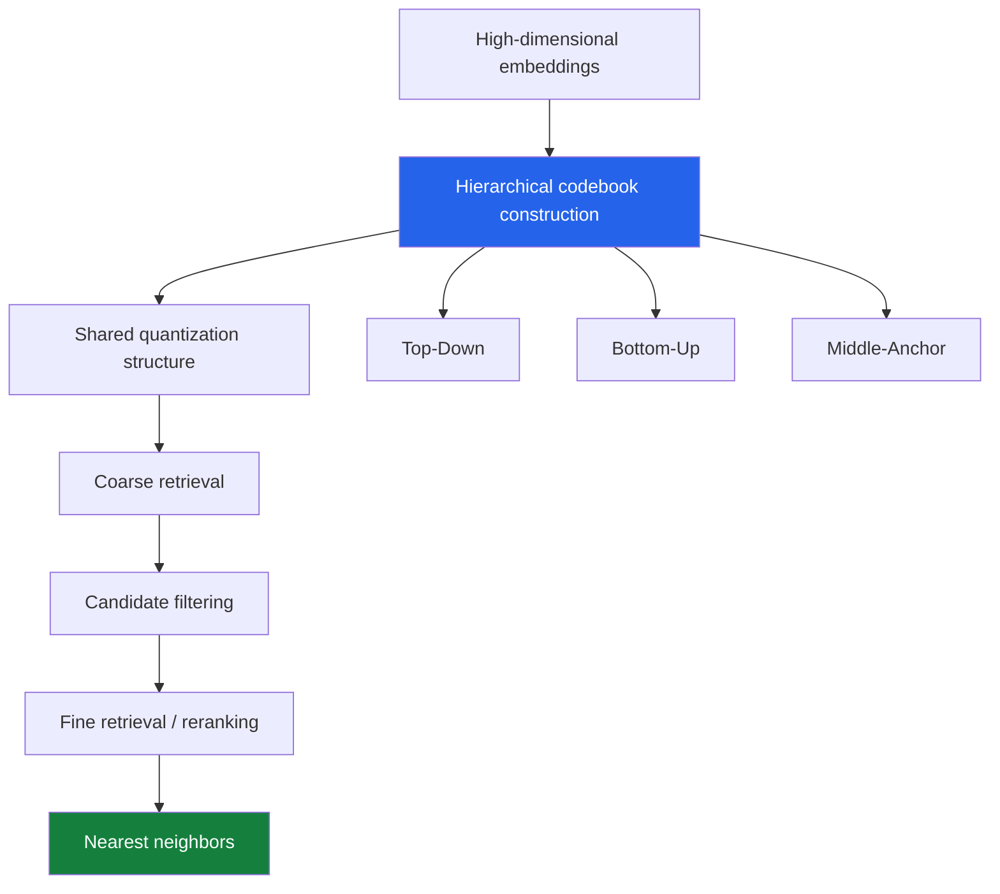
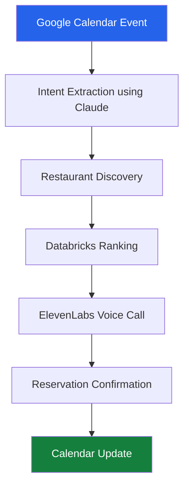

# Shashwat Saket 👋

<p align="center">
  
</p>

<p align="center">
  <a href="https://linkedin.com/in/shashwatsaket46"></a>
  <a href="https://github.com/shashwatsaket46"></a>
  <a href="mailto:shashwat.saket@nyu.edu"></a>
</p>

I'm a Computer Science graduate student at **New York University**, interested in machine learning, representation learning, and computational neuroscience.

My research has taken me from studying hierarchical vector quantization for efficient nearest-neighbor search to integrating molecular and connectivity data to understand biological neural networks.

I enjoy getting into the details of a problem: understanding the mathematics, implementing an idea, running experiments, and figuring out why something works or doesn't.

Previously, I worked as a Software Engineer at **CGI Inc.**, where I built enterprise applications, intelligent automation systems, and ML-powered services.

---

# 🔬 Research

## Understanding Neural Connectivity Through Biological Data

**Graduate Researcher | NYU Neuroinformatics Lab**  
*New York University · May 2026 – Present*

Working with Prof. Erdem Varol on the Drosophila visual system, investigating the relationship between neuronal connectivity and gene expression.

The broader goal is to understand whether molecular information can help explain the connectivity patterns observed in biological neural networks.

My current work includes:

- Integrating connectome, transcriptomic, and gene-expression datasets.
- Developing computational methods for neuronal cell-type identification.
- Investigating gene-pair associations between presynaptic and postsynaptic neurons.
- Building transformer-based filtering and analysis pipelines.
- Running large-scale experiments using GPU-accelerated infrastructure.
- Exploring connectivity patterns across different neuropils and neural circuits.

I'm particularly interested in connecting molecular identity with the structure of neural circuits.

**Research areas:** Connectomics · Multimodal Learning · Computational Neuroscience · Graph Machine Learning · Biological Data Integration

---

# 🧠 Featured Research

## 1. Reusable Hierarchical Codebooks for Approximate Nearest-Neighbor Search

**Research project: Reusable Codebooks: Hierarchical TurboQuant Quantization for Two-Tier Approximate Nearest-Neighbor Retrieval**

This project explores a question in efficient vector search: can we reuse a hierarchical quantization structure across multiple retrieval stages instead of independently constructing codebooks for each stage?

Building on ideas from Google's TurboQuant, I worked on hierarchical codebook construction strategies for two-tier approximate nearest-neighbor retrieval.

The idea is to use a shared quantization structure for coarse candidate filtering and finer retrieval, reducing codebook construction overhead while retaining retrieval quality.

### Three construction strategies

We investigated three ways of constructing reusable hierarchical codebooks:

| Strategy | Approach |
|---|---|
| **Top-Down** | Start with a coarse representation and progressively refine it. |
| **Bottom-Up** | Construct finer representations first and combine them into coarser levels. |
| **Middle-Anchor** | Use an intermediate quantization level as an anchor for constructing the hierarchy. |

### Architecture



### Mathematical and theoretical analysis

Beyond implementation, an important part of this work was understanding how quantization error behaves across hierarchical levels.

I worked on the mathematical analysis of:

- Conservation of MSE Penalty.
- Monotone Penalty across hierarchical quantization levels.
- Retrieval-MSE Divergence.
- Error propagation under different codebook construction strategies.
- The relationship between reconstruction error and nearest-neighbor ranking stability.

One of the important observations is that minimizing mean squared reconstruction error does not necessarily minimize retrieval error.

Two quantization strategies can have similar reconstruction quality but behave differently when the objective is preserving nearest-neighbor rankings.

This distinction became central to understanding why different hierarchy construction strategies produce different retrieval results.

### Experimental evaluation

Evaluated the approaches on:

- GloVe-200 embeddings.
- OpenAI embeddings with 1,536 dimensions.
- OpenAI embeddings with 3,072 dimensions.

Compared against Product Quantization (PQ), TurboQuant, and Extended RaBitQ.

| Experimental finding | Result |
|---|---|
| Top-Down | Recall@1 within approximately 1 percentage point of its corresponding single-tier reference |
| Middle-Anchor | Recall@1 within approximately 1 percentage point of its corresponding single-tier reference |
| Bottom-Up | Recall@1 degradation of up to approximately 12 percentage points |
| GloVe-200 | 2.2% improvement in Recall@1 over PQ in the evaluated setting |
| Construction cost | Approximately 50×–1,300× lower in evaluated configurations |

The experiments highlighted that the placement of the quantization anchor and the direction of hierarchy construction matter considerably. Error accumulation across levels can affect retrieval performance even when reconstruction error looks reasonable.

<details>
<summary><b>Further details: experiments, theory and methodology</b></summary>

**Quantization:** Lloyd-Max quantization and hierarchical codebook construction.

**Evaluation:** Recall@1, reconstruction error, construction cost, multiple random seeds and ablation experiments.

**Baselines:** Product Quantization, TurboQuant and Extended RaBitQ.

**Main research question:** How can hierarchical codebooks be constructed and reused without introducing substantial retrieval-quality degradation?

The work investigates the distinction between MSE-optimal quantization and retrieval-optimal quantization, particularly when multiple quantization levels share a common structure.

*Research manuscript in preparation.*

</details>

---

# 🧪 Selected Machine Learning Projects

## 2. Intracortical Neural Activity Decoding

Explored neural decoding by predicting finger kinematics from intracortical neural recordings.

The project involved building an ensemble-based prediction pipeline using neural activity from 96 recording channels.

**My contributions:**

- Developed an ensemble of 22 predictive models.
- Worked with neural recordings across 312 sessions.
- Built a pipeline for predicting finger movement from neural activity.
- Experimented with model combinations and evaluation strategies.

**Reported result:** R² = 0.7373.

The project finished first among 24 participants in the associated competition.

This was particularly interesting because it connected machine learning model design with a real neuroscience problem: understanding how movement-related information is represented in neural activity.

## 3. Scaling Laws in Musical Sequence Generation

*September 2025 – February 2026*

An exploration of scaling laws in generative models using symbolic musical data instead of conventional text datasets.

The project involved building an end-to-end pipeline:

```text
MIDICaps Dataset
       |
       v
MIDI to ABC Conversion
       |
       v
Tokenization
       |
       v
Vocabulary Construction
       |
       v
Training / Validation / Test
       |
       v
Sequence Modeling
       |
       v
Generated Music
```

**Models explored:**

- nanoGPT (~29M parameters).
- Transformer architectures.
- LSTM models as baseline comparisons.

**What I worked on:**

- Built the preprocessing pipeline for symbolic music representation.
- Implemented MIDI-to-ABC conversion.
- Developed tokenization and vocabulary construction.
- Trained and compared different sequence-modeling architectures.
- Studied how model size and data representation affect generation quality.
- Generated playable musical sequences from trained models.

An interesting observation was that Transformers handled long-range musical dependencies better than the LSTM baselines in our experiments.

[View the project repository](https://github.com/shashwatsaket46/Scaling-Law-Musical-MIDI-Data--ML-Project)

## 4. Erica AI: Knowledge Graph-Based RAG

*October 2025 – December 2025*

Built Erica AI to explore how structured knowledge can make LLM-based systems more reliable and contextually consistent.

Instead of relying entirely on vector similarity, the system combines semantic retrieval with a knowledge graph.

**What I built:**

- A Neo4j knowledge graph containing 5,000+ nodes.
- An LLM-driven semantic extraction pipeline.
- Structured concepts, definitions, and prerequisite relationships.
- Vector-based semantic retrieval.
- Graph-constrained retrieval and subgraph reasoning.
- Asynchronous ingestion and inference pipelines.

The system combines FastAPI, Docker, Neo4j, embeddings, and local LLM inference through Ollama.

The interesting part was exploring how structured relationships can provide context that ordinary similarity-based retrieval might miss.

---

# 🚀 Engineering & Applied AI

## ReservaDirect: Autonomous AI Reservation Agent

**Tech@NYU Hackathon · HOF Office**

Built an autonomous system that connects Google Calendar with real-world restaurant reservations.

Users create a calendar event with their reservation preferences. The system extracts the booking requirements, finds suitable restaurants, and places AI-powered voice calls to make the reservation.

**The pipeline:**



Implemented automated reservation creation, updates, and cancellations through calendar webhook triggers.

**Technologies:** Python · FastAPI · React · Claude · Databricks · ElevenLabs · Docker

<p align="center">
  <a href="https://www.youtube.com/watch?v=ZCsI_wIn5to">
    
  </a>
  <br/>
  <a href="https://www.youtube.com/watch?v=ZCsI_wIn5to">▶ Watch the demo</a>
  ·
  <a href="https://github.com/shashwatsaket46/ReservaDirect">Source code</a>
</p>

---

# 📚 Earlier Research & Projects

A few other problems I've explored during my undergraduate and graduate journey.

<details>
<summary><b>Crop Prediction Using Metaheuristic Optimization</b></summary>

Explored crop prediction using machine learning and optimization techniques.

Worked with metaheuristic approaches including:

- Cuckoo Search.
- Particle Swarm Optimization.
- Ant Colony Optimization.

Focused on feature optimization and evaluating the effect of different search strategies on predictive performance.

</details>

<details>
<summary><b>NLP-Based Propaganda Detection</b></summary>

Worked on identifying propaganda patterns in news articles using natural language processing and deep learning.

Explored text preprocessing, representation learning, and classification models for unstructured textual data.

</details>

<details>
<summary><b>COVID-19 Travel Optimization</b></summary>

Explored optimization approaches for travel-related problems during the COVID-19 period, including Ant Colony Optimization and Honey Bee Mating Optimization.

This work contributed to my earlier research experience in metaheuristic optimization.

</details>

---

# 💼 Professional Experience

### Software Engineer | CGI Inc.
*August 2023 – September 2025*

Worked on enterprise applications, conversational AI, and intelligent automation.

A few contributions:

- Developed NLP-based conversational AI modules that automated approximately 40% of targeted enterprise workflows.
- Built Camunda-based ML microservices, improving deployment throughput by 35%.
- Implemented anomaly detection workflows for financial datasets, improving detection accuracy by 25%.
- Developed backend services and distributed application components.
- Worked across ML integration, backend engineering, and enterprise systems.

My time at CGI gave me experience taking ideas beyond experimentation and building systems that work in real production environments.

---

# 📄 Publications

- Research publication in *Cluster Computing* (Springer).

My current research also includes work on reusable hierarchical codebooks and multimodal machine learning for computational neuroscience.

---

# ⚙️ Tools I Use

**Machine Learning & Deep Learning**

<p>
  
</p>

**Data Science & Scientific Computing**

<p>
  
</p>

**Backend & Distributed Systems**

<p>
  
</p>

**Infrastructure & Development**

<p>
  
</p>

---

# 📊 GitHub Activity

<p align="center">
  
</p>

---

# 📫 Let's Connect

I'm always interested in connecting with people working on machine learning, algorithms, computational biology, and interesting research problems.

- **LinkedIn:** [shashwatsaket46](https://linkedin.com/in/shashwatsaket46)
- **GitHub:** [shashwatsaket46](https://github.com/shashwatsaket46)
- **Email:** [shashwat.saket@nyu.edu](mailto:shashwat.saket@nyu.edu)

<p align="center">
  <i>Interested in understanding why algorithms work, not just making them work.</i>
</p>
